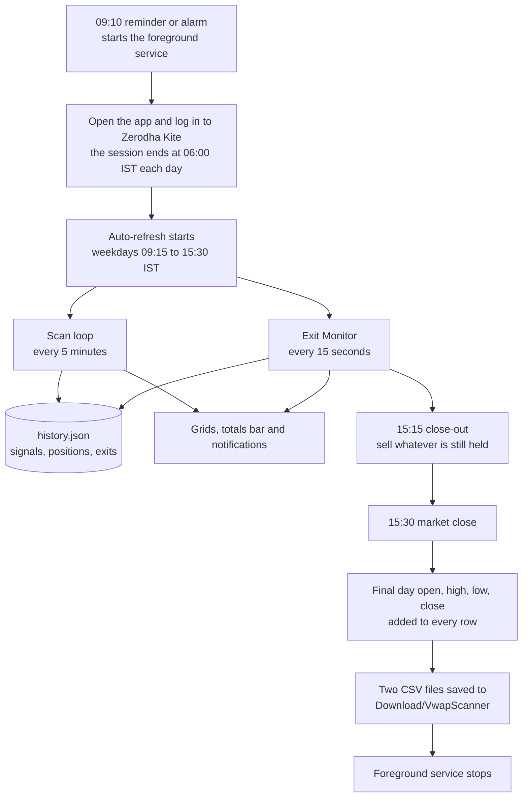
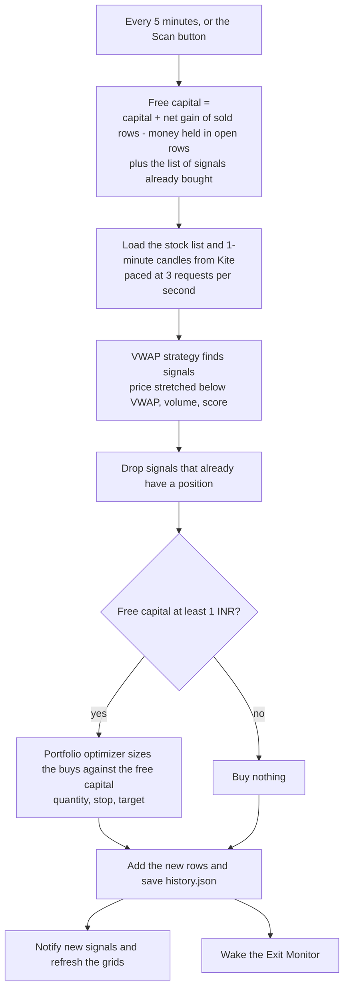
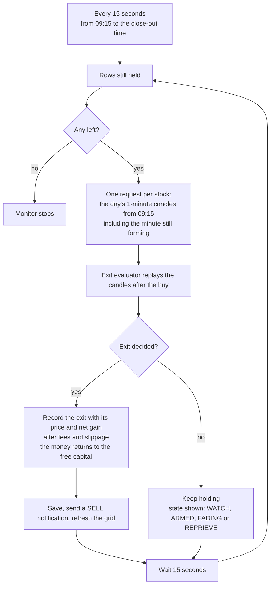
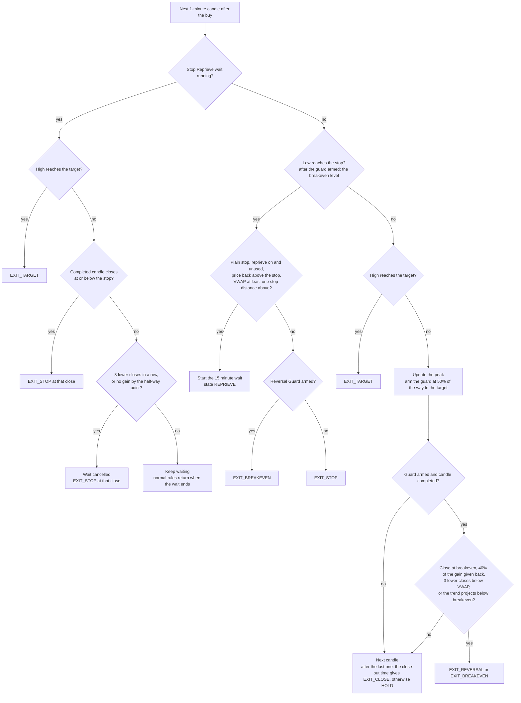

# VWAP Scanner: end to end flow

How the Android app scans, buys, watches and sells during one trading day, as of 6 November 2026.

## 1. A trading day, start to finish

Two loops run side by side while the market is open. The scan finds and buys. The Exit Monitor decides when to sell. Both write to the same saved history.

## 2. The scan loop: finding and buying

The capital balance is worked out first, so a scan can never spend more than what is free.

## 3. The Exit Monitor loop: watching and selling

It runs apart from the scan, so a slow scan never delays an exit. Both share one Kite connection and one request pacer.

## 4. How one row is judged, candle by candle

The evaluator replays every 1-minute candle after the buy in order, so a restart gives the same answer as running all day.

## Exit statuses

| Status | Meaning |
|---|---|
| `HOLD` | Keep the position. Guard state: WATCH, ARMED, FADING, or REPRIEVE while a stop wait runs. |
| `EXIT_TARGET` | The high reached the target. Sell at the target. |
| `EXIT_STOP` | The stop was reached, or a stop wait ended badly. The reason column says which. |
| `EXIT_BREAKEVEN` | The price came back to the buy price after the guard armed. |
| `EXIT_REVERSAL` | A rise is fading. Sell before it turns into a loss. |
| `EXIT_CLOSE` | Still held at the close-out time (15:15 by default). Sell at the market. |

## What is saved where

| Item | Content |
|---|---|
| history.json | Signals, portfolio rows, exits and day OHLC for today. Read again after an app restart. |
| CSV files | vwap-signals and vwap-portfolio, saved to Download/VwapScanner at the close. |
| Daily log | Kite and app errors with secrets removed. Share it from Settings. |
| Settings | Capital and risk limits, auto-refresh, Exit Monitor, Reversal Guard, Stop Reprieve. |
